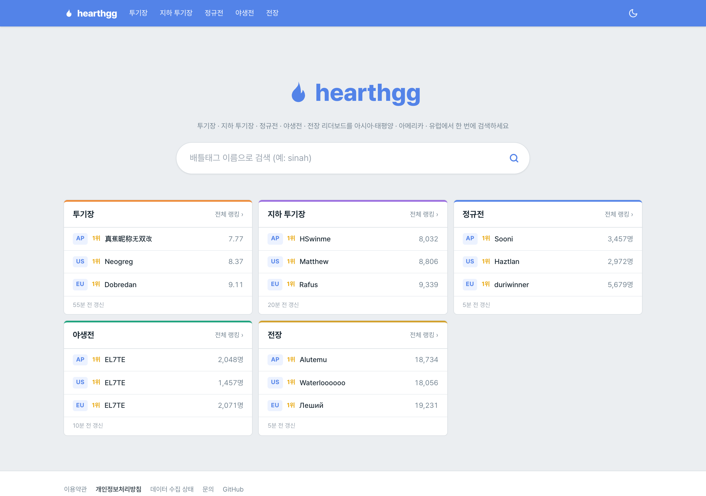
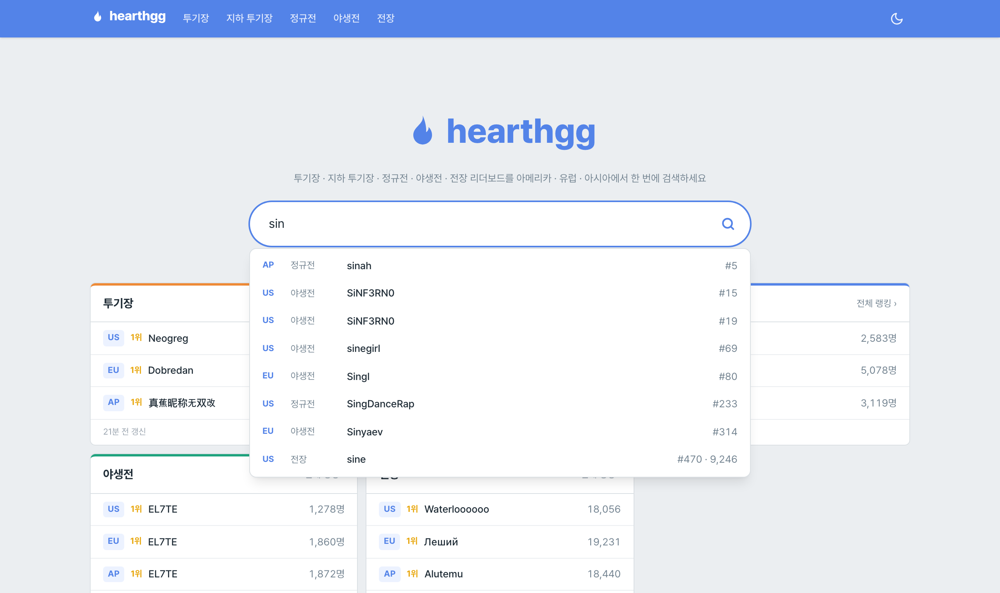
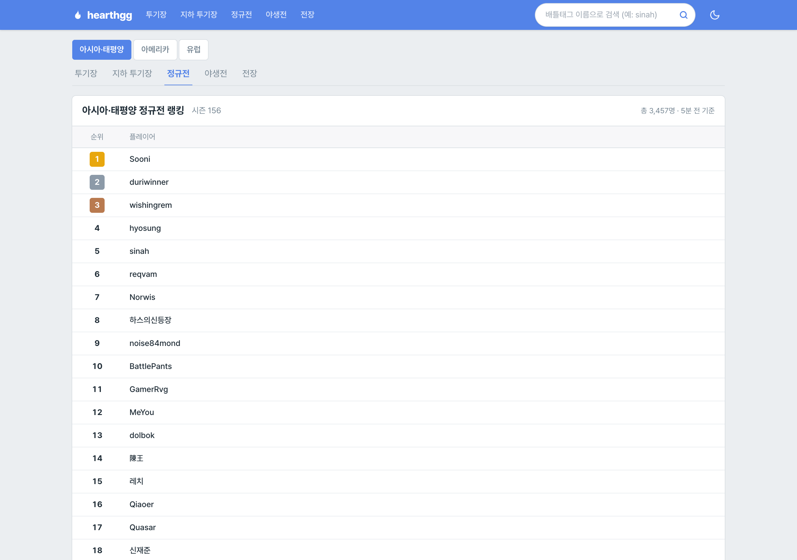
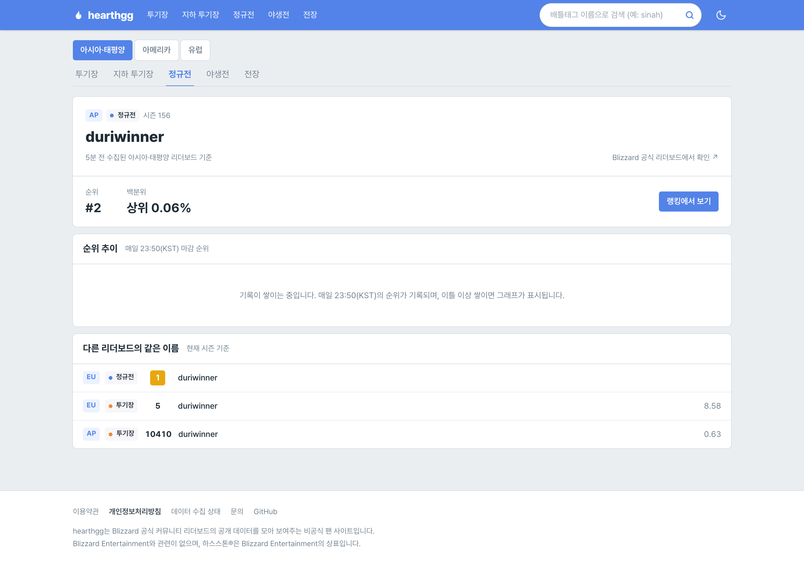
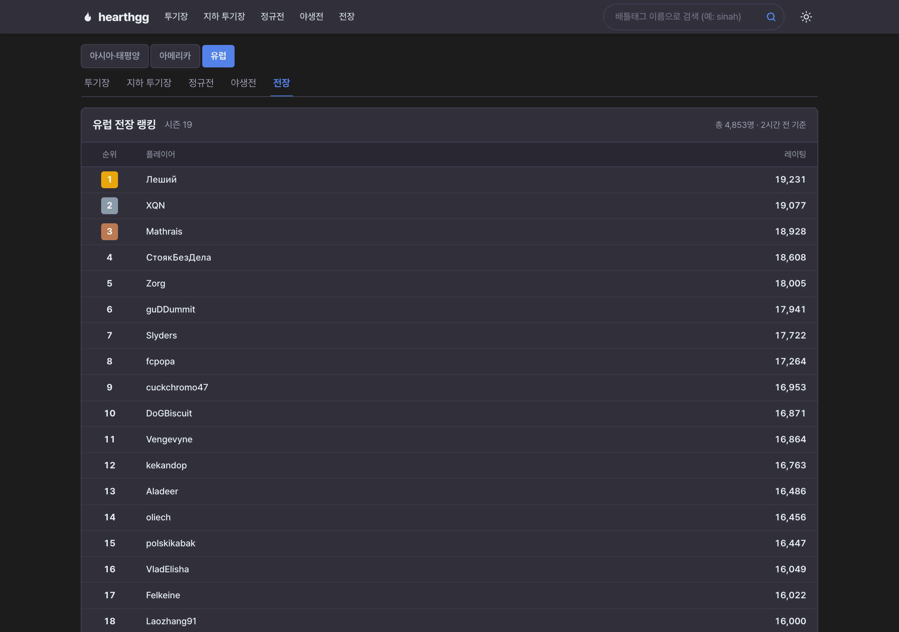
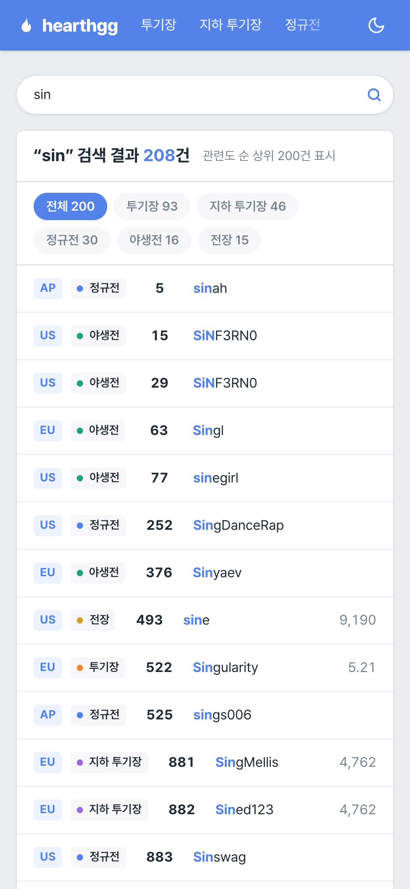
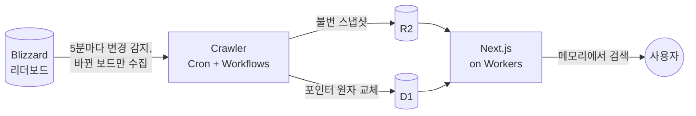

<p align="center">
  
</p>

<h1 align="center">hearthgg</h1>

<p align="center">
  <b>하스스톤 랭킹, 이름만 입력하면 바로 찾습니다.</b><br>
  투기장 · 지하 투기장 · 정규전 · 야생전 · 전장 리더보드를<br>
  아메리카 · 유럽 · 아시아·태평양 전 지역에서 한 번에 검색하세요.
</p>

<p align="center">
  <a href="https://rank.hsgg.workers.dev"><b>hearthgg 바로가기 →</b></a>
</p>

<p align="center">
  <a href="https://github.com/TaeBbong/hearthgg/actions/workflows/ci.yml"></a>
  
  
  
</p>

---

Blizzard 공식 리더보드는 모드와 지역마다 따로, 25명씩 페이지를 넘겨 가며 봐야 합니다. 투기장 리더보드만 해도 지역마다 1만~2만 명이 올라 있어서, 내 순위를 찾는 일이 생각보다 번거롭습니다.

**hearthgg**는 15개 리더보드(5개 모드 × 3개 지역)를 주기적으로 모아 두고, 이름 한 번 입력으로 전부 찾아 줍니다.

## 주요 기능

### 🔎 전 지역 통합 검색

이름의 일부만 입력해도 15개 리더보드에서 바로 후보를 보여줍니다. 대소문자와 전각 문자를 구분하지 않고, 정확히 일치하는 이름이 먼저 나옵니다. 키보드만으로도 고를 수 있습니다.

<p align="center"></p>

### 📋 리더보드 탐색

지역과 모드를 탭으로 바꿔 가며 봅니다. 각 리더보드에는 마지막 수집 시각이 함께 표시되고, 시즌이 바뀌면 지난 시즌의 최종 순위도 남겨 둡니다.

<p align="center"></p>

### 👤 플레이어 페이지

순위, 레이팅, 상위 몇 %인지와 함께, 같은 이름이 다른 모드·지역 리더보드에 있는지도 보여줍니다. 매일 마감 순위를 기록해 **순위 추이 그래프**를 그리고, 배틀태그 번호가 공개되지 않아 생기는 동명이인도 구분해 안내합니다. 공유하기 좋은 고유 주소(`/ap/arena/56/이름`)를 가집니다.

<p align="center"></p>

### 🌙 다크 모드 · 📱 모바일

<table>
  <tr>
    <td width="68%"></td>
    <td width="32%"></td>
  </tr>
</table>

## 지원 범위

| | |
|---|---|
| **모드** | 투기장, 지하 투기장, 정규전, 야생전, 전장 |
| **지역** | 아메리카(US), 유럽(EU), 아시아·태평양(AP) |
| **갱신 (아시아·태평양 우선)** | 아시아·태평양: 상위 1,000위는 순위가 바뀌면 약 5~10분 간격, 전체 순위는 1시간마다 |
| | 아메리카·유럽: 상위 1,000위는 약 10~15분 간격, 전체 순위는 2시간마다 |
| **기록** | 매일 23:50(KST) 마감 순위를 저장해 추이 그래프로 제공 |

## 어떻게 만들었나



- **사용자는 블리자드를 기다리지 않습니다.** 사용자 요청은 원본 API를 호출하지 않습니다. 미리 모아 둔 스냅샷을 Worker 메모리에 올려 두고 그 자리에서 검색합니다.
- **원본 서버를 배려하는 크롤러.** 1페이지 해시로 바뀐 보드만 골라 수집하고, 상위 1,000위는 자주, 나머지는 드물게 읽습니다. 한국 사용자가 주로 보는 아시아·태평양은 더 짧은 주기로, 더 먼저 수집합니다. 모든 수집이 시간당 3,000건짜리 토큰 버킷 하나를 공유하고, 403/429를 받으면 전역 서킷 브레이커가 모든 요청을 멈춘 뒤 점점 길게 쉬었다가 천천히 속도를 회복합니다.
- **중간에 끊겨도 이어서, 섞이지 않게.** 수집은 Cloudflare Workflows의 step 단위로 저장돼 실패한 지점부터 다시 시작합니다. D1 compare-and-swap 잠금과 "더 새로운 스냅샷만 교체" 규칙으로 동시 실행이나 반쯤 쓰인 데이터가 사용자에게 보이지 않습니다.
- **서버 없이 월 $5.** Workers, Workflows, D1, R2만으로 수집부터 서비스까지 운영합니다.
- **테스트로 확인합니다.** TDD로 개발했고, 단위 테스트 205개(크롤러는 실제 workerd 런타임과 D1/R2 위에서 실행)와 데스크톱·모바일 Playwright E2E 36개가 GitHub Actions에서 돕니다.
- **조용히 멈추지 않습니다.** 장애와 복구, 매일의 수집 리포트가 Discord로 옵니다.

| 영역 | 기술 |
|---|---|
| 웹 | Next.js 16 (App Router), React 19, Tailwind CSS 4, Pretendard |
| 인프라 | Cloudflare Workers · Workflows · D1 · R2, OpenNext |
| 언어 · 검증 | TypeScript (strict), zod |
| 테스트 · CI | Vitest, Testing Library, `@cloudflare/vitest-pool-workers`, Playwright, GitHub Actions |

설계 근거와 세부 동작은 [설계 문서](docs/architecture.md)에 정리했습니다.

## 직접 실행하기

Node 22.12 이상이 필요합니다.

```bash
npm install
npm test                                   # 단위 테스트 (core · crawler · web)
npm run test:e2e -w web                    # E2E (처음 한 번: npx playwright install chromium)

# 고정 데이터로 화면 보기 (Blizzard 호출 없음)
cd apps/web && HEARTHGG_STATE_DIR=.wrangler/e2e-state npm run dev
```

실데이터 로컬 수집과 Cloudflare 배포 방법은 [설계 문서](docs/architecture.md#로컬-개발)를 참고하세요.

```
packages/core   도메인 로직: Blizzard 클라이언트, 스냅샷, 갱신 판단, 검색, 히스토리
apps/crawler    Cron + Workflows 수집기 (D1/R2 쓰기)
apps/web        Next.js 웹 앱 (D1/R2 읽기)
migrations      D1 스키마
```

---

<sub>
hearthgg는 Blizzard 공식 커뮤니티 리더보드의 공개 데이터를 모아 보여주는 비공식 팬 사이트이며, Blizzard Entertainment와 관련이 없습니다. 하스스톤®은 Blizzard Entertainment의 상표입니다.<br>
Flutter Web + Flask로 만들었던 첫 버전은 <a href="https://github.com/TaeBbong/hearthgg/tree/v1-flutter"><code>v1-flutter</code></a> 태그에 남아 있습니다.
</sub>
